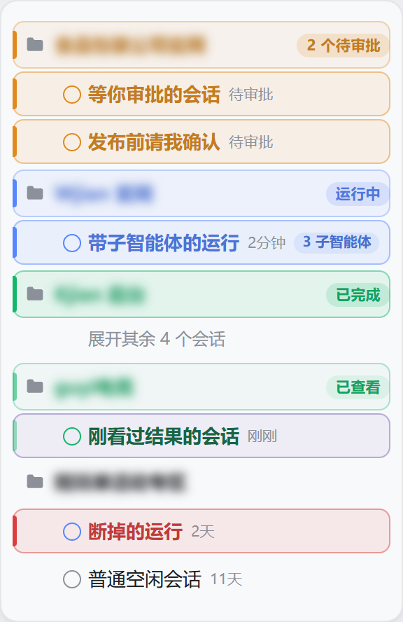
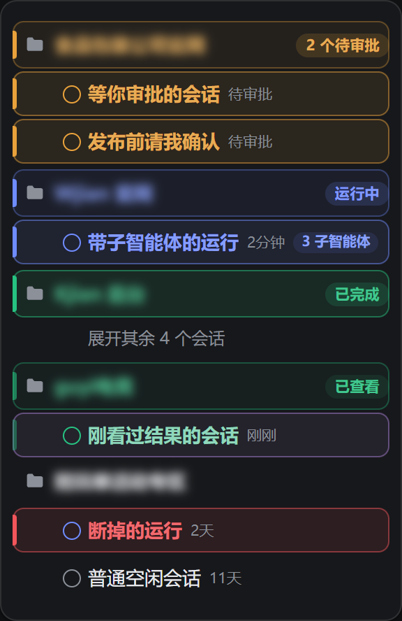

# dsh-plugin-busy-workspace

**在侧栏里指出哪个工作区正在干活。**

DeepSeek Harness（`dsh`）Web 界面插件：高亮正在工作的会话，并把有任务在跑的工作区置顶到侧栏最前。

[](LICENSE)
[](https://github.com/topics/dsh-plugin)
[](#配色跟随主题)

---



*一屏五个阶段，按紧急度浮到最前：待处理（琥珀）在最前，接着是运行中（蓝，带子智能体计数）、已完成未读（绿）、已查看（就是被选中那行，用插件自己的紫罗兰），最后一个已经断掉的运行（红）只标记、不置顶。那个绿色的工作区把四条会话收在了官方的"展开其余 N 个会话"后面：报出这条完成的行已经不在屏上了，文件夹行照样报出状态、照样留在原位。图里的竖条、色底、描边环、徽标、胶囊全部来自插件自己的 CSS，由它自己的 `paint()` 读取真实的 `data-state` 驱动。列表内容是 fixture，工作区名做了模糊处理——真实侧栏里有哪些工作区，每台机器都不一样；重跑 `node scripts/capture-screenshots.mjs` 即可重新生成。*

---

## 解决的痛点

同时跑多个 agent 的时候，`dsh` 侧栏会变成一堵长得一模一样的墙。每个工作区标题长得一样，每条会话行长得一样，唯一能说明"有东西在跑"的信号，是一个十个像素、还灰扑扑的小圆点。

于是就出现了这些反复发生的问题：

| 现象 | 代价 |
| --- | --- |
| 看不出哪个工作区里有 agent 正在执行 | 只能逐个点开工作区确认，或者误打断一个本来跑得好好的会话 |
| 你一动别的工作区，忙碌的那个就沉到列表下面 | 你真正关心的那个，恰恰是需要滚动才能找到的 |
| 会话跑完了没有任何提示 | 你一直在等一个早就结束的任务，或者错过了查看产出的时机 |
| 状态点又小又灰、对比度低，是唯一的线索 | 退后一步、或者屏幕小一点，就完全读不出来 |

现有的主题和皮肤会把整个界面重新配色，但没有一个回答并行工作时最关键的那个问题：**现在到底哪一个在跑？**

## 插件做了什么

这个插件回答两个不同的问题：**现在有什么在动**，以及**我刚才开的东西去哪了**。把这两个问题混在一起，正是它早期版本最要命的缺陷——详见下面"完成后仍然留得住"。

### 一、按紧急度浮到最前

带活跃会话的工作区升到列表顶部，**并且按紧急度排序**：等你处理的排最前，其次运行中，再次已完成（未读），最后是已查看。所以同时有三个工作区在动时，第一个永远是那个卡在你这儿的。

位置变化**只是视觉上的**——你手动拖拽的工作区顺序不会被改写，工作停下来后列表会安静地恢复成你排好的样子。

### 二、五个注意力阶段，五种视觉分量

会话行按「注意力阶段」着色，每一种颜色都直接取该状态点自身绘制时用的变量，所以行和点永远不可能各说各话：

| 阶段 | 何时进入 | 颜色 | 是否置顶 |
| --- | --- | --- | --- |
| 待处理 | `warning`：等你审批 / 审计划 / 回答 | 琥珀 | 是，**最高** |
| 运行中 | `ongoing`，且最近有活动 | 蓝 | 是 |
| 已完成（未读） | `done`：跑完了，你还没打开过 | 绿 | 是，保留 8 小时 |
| 已查看 | 你打开看过，结论已读 | 绿，**褪色** | 是，选中时一直留，离开后 15 分钟 |
| 已中断 | 自称运行，但已静默超过 6 小时 | 红 | **否**，只标记 |

每行获得：左缘一条 3px 实心色条、同色系淡底与描边环、加重着色的标题。只有"运行中"会动；其余阶段都是静止的——一条会搏动的红行读起来像警报，而不是报告。

**三种"等你处理"共用琥珀一色，靠文字区分。** 官方把等待分成审批、审计划、回答三类；它们都是"卡在你这儿"，再拆三种色相只会让人重新学一遍。所以插件直接复用官方写在该行上的词——徽标会写「待审批」「计划待审」或「待回答」，而不是笼统的"待处理"。同理，**子智能体不是一个颜色，而是一个计数**：官方把"3 个子智能体运行中"渲染成隐藏标签，插件把它变成运行行上的小胶囊「3 子智能体」。

### 三、完成后仍然留得住（这是早期版本最大的错）

官方的 `done` 语义是 `completionUnread`——**完成但你没打开过**，而这个标记在你点开那条会话的瞬间就被清除。于是天真的读法会造成一个荒谬的结果：**你正因为想看结果而点开它，它却恰好在这个时候从置顶区消失，你正在读的那一行跳走了。**

插件的做法是：**置顶要衰减，不能瞬断。**

- 打开一条完成会话，只会把它从"未读"变成"已查看"，**它继续留在置顶区**；
- 只要你**还停在那一行**，它就一直留着——无论你读多久；
- 等你切到别的会话，才开始计 15 分钟，然后才释放。
- 从未打开的完成会保留 8 小时——够你离座吃饭再回来，但昨天以前的活儿不会再来打扰你。

**刷新页面不会丢。** 这些不需要持久化：官方自己就存着"你看过没有"。重载后仍未打开的完成依旧是 `done`，按年龄继续保留；已经看过的是 `idle`，安静待在原地。

### 四、会话跑完的那一刻你看得见

会话停止运行时，那一行会播一次短促的绿色收敛脉冲，然后恢复正常。任务完成时你会知道，不必一直盯着。

## 配色跟随主题



*同一份样式表、同样五个阶段，换到默认深色主题。插件自己不定义任何颜色，所以这里没有需要同步的东西。*

所有颜色都取自当前主题自己的 `--dsw-alias-*` / `--dsw-static-*` 变量，没有任何硬编码色值。这意味着同一份样式表可以同时适配内置的明暗主题，以及社区主题包（Catppuccin、Nord、Dracula、Tokyo Night、Gruvbox，以及任何定义了标准变量集的主题）。

| 用途 | 取用变量 |
| --- | --- |
| 运行中（同 `ongoing` 状态点） | `--dsw-static-deepseek-450` |
| 待处理（同 `warning` 状态点） | `--dsw-alias-state-warn-primary` |
| 已完成 / 已查看（同 `done` 状态点） | `--dsw-alias-state-success-primary` |
| 已中断 | `--dsw-alias-state-error-primary` |
| **选中**（独立第 5 色系，紫罗兰） | 由 `--bw-running` 与 `--bw-interrupted` 混合 |
| 行标题 | `--dsw-alias-label-primary` |

每个阶段声明一次 `--bw-tone`，其余规则统一写在这个变量上，所以五种状态分量不会各自漂移。共用一个状态点的变量也意味着插件留在主题自己的词汇表里：主题调整了状态点，高亮会跟着一起调。

"已查看"用的是**同一个绿色**，只是把 `--bw-fade` 调到 0.42——它不是另一种状态，而是同一种完成正在退场。

透明度用 `color-mix()` 与主题自身的表面色合成，所以浅色和深色背景下色块都落在正确的位置。默认主题里运行态变量在浅色下解析为 `#5686fe`、在深色下解析为更亮的蓝，而插件并不知道这两个值。

### 选中是独立的一族，不借用任何状态色

**这是修掉"选中的行和运行中的行长得一样"的关键。** 之前选中行保留官方那层 6% 中性底，但**描边环仍用状态色**；而状态色同时还染着竖条和标题——于是一行"既被选中又在跑"在三个通道上全是蓝的，看起来就只是又一个运行行。

现在选中走自己的色系，而且**和四个状态是同一种处理方式**：一个饱和色相铺成淡色底（权重完全相同，都是 `--bw-fill-alpha`），描边环用同一色相的加深版。区别只在色相本身。状态仍由**左缘竖条**与**标题色**承载——那本来就是这两个元素的职责。效果是：

| 行 | 表面 | 描边环 | 左缘竖条 |
| --- | --- | --- | --- |
| 在跑 · 已选中 | 紫 `9.6%` | 紫 | 蓝 |
| 在跑 · 未选中 | 蓝 `9.6%` | 蓝 | 蓝 |
| 空闲 · 已选中 | 紫 `9.6%` | 紫 | 无 |

选中的外观因此与底下是什么状态无关：无论运行、等待、完成还是普通会话，被选中就得到同一套紫色。实测色值：选中 `rgb(126,92,187)`（紫罗兰），与运行 `rgb(77,107,254)` 色距 84、与待处理 191、与已完成 163、与已中断 157——四态都拉得很开。

**为什么是"混"出来的紫？** 因为 Harness 的调色板只有六个色相族（amber / blue / deepseek / green / neutral / red），四个状态已经占掉四个，没有第五个色相可用；而 `--dsw-alias-brand-primary` 解析为近黑/近白，不是色相。于是选中由主题自己的两个亮色 token（运行蓝 + 失败红）按约 2:1 混出紫罗兰：它**按构造就不等于任何四态色相**，同时仍然跟着主题走，而不是钉死一个写死的色值。

想换成别的色相，覆写 `--bw-selection` 与 `--bw-selection-ring` 两个变量即可，不必动任何规则：

```css
--bw-selection: #d946a8;              /* 换成任何你喜欢的色相 */
--bw-selection-ring: color-mix(in srgb, var(--bw-selection) 52%, transparent);
```

觉得选中还不够醒目，把 `--bw-selection` 的混合比例调浓，或在选中规则里把 `--bw-fill-alpha` 的倍数从 `100%` 提高即可（默认与状态行同权重，所以不会盖过状态）。

填充刻意只做衬托：真正承载信号的是有形状的东西——3px 实心竖条，和工作区标题上写明状态的胶囊徽标。旧版把"运行中"主要表达为蓝色标题，可官方行标题本来就是蓝的，那个信号等于不存在。

## 安装

```sh
dsh plugin --profile web add dsh-plugin-busy-workspace
```

就这一条命令。插件已发布到 npm；不会触发任何构建——`lib/` 是随包发布好的产物，没有运行时依赖，唯一的官方包是 profile 本来就提供的 peer。

不想走 npm 也可以，同一个包能从仓库或 Release 页上的预构建 tarball 装：

```sh
dsh plugin --profile web add github:baifagg/dsh-plugin-busy-workspace
dsh plugin --profile web add https://github.com/baifagg/dsh-plugin-busy-workspace/releases/latest/download/dsh-plugin-busy-workspace.tgz
```

两种方式都需要把 bundle 列进该 profile 的 `package.json`：

```json
{
  "dsh": {
    "profile": {
      "bundles": [
        "...",
        "dsh-plugin-busy-workspace"
      ]
    }
  }
}
```

`dsh plugin add` 会替你写好这一项；如果你是手工 `pnpm add` 的，就自己补上。之后重启 Web 界面并刷新页面，侧栏即生效，无需其他配置。

导入插件之前，Harness 会先校验本插件声明的版本范围（见[兼容性](#兼容性)）。被拒绝的版本会被跳过并报告，不会出现"加载了一半"的状态。

## 配置

配置持久化在 `$DSH_HOME/busy-workspace/settings.json`，通过 `GET /busy-workspace/api/settings` 提供。

```json
{
  "pinBusyWorkspaces": true,
  "highlightRunningSessions": true,
  "highlightBusyWorkspaceHeaders": true,
  "notifyOnCompletion": true,
  "intensity": 0.6
}
```

| 字段 | 默认 | 作用 |
| --- | --- | --- |
| `pinBusyWorkspaces` | `true` | 把带活跃会话的工作区按紧急度提到列表最前 |
| `highlightRunningSessions` | `true` | 为各阶段的会话行绘制对应的色条、底色与着色标题 |
| `highlightBusyWorkspaceHeaders` | `true` | 为活跃工作区的标题行加上同色系底色、竖条与状态徽标 |
| `notifyOnCompletion` | `true` | 会话停止运行时播放收敛脉冲 |
| `intensity` | `0.6` | 强调强度，`0`–`1`。只缩放透明度，色相始终来自主题 |
| `unreadHoldMinutes` | `480` | 未打开的完成保留多久（8 小时）。范围 `0`–`10080` |
| `seenHoldMinutes` | `15` | 打开过、且你已移开的完成，再保留多久。范围 `0`–`1440` |
| `staleRunMinutes` | `360` | 自称运行但静默多久后判为已中断（6 小时）。范围 `30`–`10080` |

后三个是**保留策略**，做成可调字段而不是常量，因为它们描述的是工作节奏、不是事实。把它们调到 `0` 就等于让"完成"完全不留痕；把 `unreadHoldMinutes` 调到 `10080` 就是留一星期。

Host 侧是可选的。只挂载客户端 bundle 的组合会使用上述默认值，这本身就是一套完整可用的配置。

## 实现原理

插件读取 Harness 已经渲染在每条会话行上的状态点的 `data-state` 属性。这个属性就是官方契约，它只有四个取值，来自 Harness 自己的 `sessionStatuses` / `sessionNode` 推导，并自带优先级：`warning`（待你处理，压过一切）→ `ongoing`（运行中）→ `done`（完成但未读）→ `idle`。

但**官方四态不足以表达"你回来看结果"这件事**，所以插件在其上维护自己的**注意力阶段**：多出来的信息只有两样——你是否已经确认看过，以及你是否正停在这一行。这两样都不需要持久化：官方自己就存着"看过没有"，重载后照读即可。

阶段转换规则（也就是 `assess()` 的全部逻辑）：

- `warning` → **待处理**；永不按年龄降级，因为它卡着你。
- `ongoing` 且年龄 < `staleRunMinutes` → **运行中**；否则 **已中断**（标红但不置顶）。
- `done` 且年龄 ≤ `unreadHoldMinutes` → **已完成（未读）**；更老则完全安静。
- `done → idle` 的转换（打开会话正是这个效果）→ **已查看**。若该行同时被选中，它的驻留计时器每一帧都被重置，所以读多久都不会掉出置顶区；离开后才开始计 `seenHoldMinutes`。

关于选择器，有三处是承重的：

- **状态点必须同时是状态点自己那个节点。** 一行最左侧的 16px 单元格渲染的**要么**是状态点，**要么**是别的插件通过 `sidebar.session.row.leading` 放进去的座位。所以插件要求 `aria-hidden="true"`（`StateDot` 总会设）并把取值限制在官方四态之内——否则一个外来元素（比如安装器那个 `error` 标记）会被误读成会话状态。会话行本身**不存在** `error` 状态。
- **子智能体计数来自行内的隐藏标签**，而单位词直接取自那条标签本身（`子智能体` / `subagent(s)`），因此胶囊是自动本地化的，插件不必自带翻译。
- **时间标签被回读**，它是行的直接子元素，插件从中解析相对年龄，用于上面所有年龄判断。等待中的行在这个位置显示的是"待审批"之类的词而非年龄，解析结果为空——这正是想要的；同时那个词会被复用为工作区徽标文字。

工作区提升使用 flex 列表列上的 CSS `order`。官方列表本身是普通块级滚动容器，所以插件先在**工作区分组的父元素**上打一个标记属性，由 CSS 把它变成 flex 列；直接重排节点会和 React 冲突，而 `order` 是纯表现层提示，渲染器从不回读。**排序也走同一条路**：`data-busy-rank` 为 4/3/2/1 的分组分别拿到 `order: -4/-3/-2/-1`，所以最紧急的永远在最前。没有被提升的列表不会被改动，保持官方布局。

**文件夹行要能替它藏起来的行说话。** 官方列表每个工作区只在屏上留 5 条空闲会话，其余收在"展开其余 N 个会话"后面——所以你离开时完成的那条，很可能正是被收起来的那条，于是屏上再没有任何一行能说明这个工作区值得打开。两件事兜住这种情况：

- **文件夹行抬到与会话行同级。** 列表正在藏行的那个工作区会带上 `data-busy-held`，它的文件夹行就不再是"摘要"：底色、描边环、竖条都取标记会话行用的同一组权重，因为它前面已经没有任何你能看见的行了。颜色同时落到文件夹图标上——那是这一行里唯一不是文字的形状。折叠的子工作区树同理（官方那行本身就是 `treeitem`，`aria-expanded` 由它自己写），因为那时文件夹行同样是唯一还在屏上的东西。
- **记住最后一次状态。** 每个工作区最近一次报出的阶段按官方的 `workspace:<id>` 行键记下来，用的是未读完成那口 `unreadHoldMinutes` 时钟，所以"行还在的时候到了的完成"，在行被收走之后仍然会被报出来。这里不凭空造状态：从没报过阶段的工作区不会留下记忆，离开列表的工作区会连记忆一起清掉。

**已中断（红）是一个推算出来的状态。** 会话行没有任何"失败"字段，所以插件把"状态点仍说 `ongoing`、但最后活动已超过 `staleRunMinutes`"读作该次运行已经断掉，并据此绘制红色而不继续冒充活跃。它因此也不参与置顶——列表不会为了一个几天前的陈旧标记而重排。

动效遵循 `prefers-reduced-motion`：要求减少动效的用户保留全部状态提示，只去掉运动本身。

## 验证

`npm test` 跑 59 项检查，不需要浏览器、不需要 Harness：Host 侧的配置归一化（含三个新时长字段的范围钳制）、客户端的模块/选择器/样式/运行时契约，以及**注意力模型的行为**。

判据最强的一组是行为级：测试用花括号配对把 `assess` / `ageOf` / `subagentsOf` 等**真实函数体**从 `lib/client.js` 里抽出来求值，喂给它们可变的伪造官方行（状态点 + 时间标签 + 选中状态 + 隐藏子智能体标签），然后像用户一样把行**推进过整个生命周期**。断言包括：

- **打开一条完成会话后它依然置顶**（`done → idle` 得到"已查看"而不是消失）——这就是本次修复的核心；
- **停在该行读 12 分钟，它一直置顶**（驻留时钟被持续重置）；
- 离开后仍有 15 分钟驻留，之后才释放；
- 未打开的完成留 8 小时；9 小时 / 11 天 / 3 个月前的完成完全安静；
- 自称运行但静默 7 小时 → 已中断，且 `rank = 0`（不置顶）；5 小时 → 仍是运行中；
- 相对年龄在中英两种语言下都能解析，`3mo` 不会被误读成分钟；
- 等待中的行永不按年龄降级，并取出官方具体词（`待审批` / `Approval`）；
- 子智能体胶囊中英双语都能组装（`3 子智能体` / `2 subagents`）；
- 外来元素带 `data-state="error"` / `"failed"` 时**不会被**读成会话状态。

**测试不是空转的**：把修复本身变异掉（删掉 `done → idle` 那一支）后重跑，**正好那 4 项保留测试失败、其余 55 项照常通过**——说明它们咬住的确实是这个行为，而不是同义反复。

样式检查断言的是上面写明的那些不变量——除变量回退外没有裸色值、标记行不用 `border`、选中走独立色系且**任何选中规则都不得引用状态色**、只有运行态有动效、减少动效时保留状态、五个状态分量都取自状态点自己的变量、强度排序的 `order` 规则齐全、徽标只统计它正在命名的那一阶段、列表容器不依赖 `role="tree"`；并有专门一项断言**选中规则在源码中排在状态规则之后**（同特异度下靠源码顺序取胜，这也是"选中在悬停时仍不被状态色覆盖"的保证）。

最后是**在真实 DOM 上跑真实的 `paint()`**：把六个工作区按与紧急度**相反**的顺序放进 DOM，运行两遍 paint（第二遍前把一行从 `done` 改成 `idle` 并选中，模拟"用户点开去读结果"），然后读回结果——实际排序为 待审批(-4) → 运行中(-3) → 已完成(-2) → 已查看(-1) → 两个 rank 0 组保持 DOM 顺序；"已查看"那条的竖条实测透明度 0.42、色值为 `rgb(18,183,106)`；"3 子智能体"胶囊从官方隐藏标签解析成功；陈旧完成行的色条与底色完全透明；所有行高仍是 32px。

客户端一半也在真实 Web 界面里跑过：模块经官方 `__ModuleLoader__` 契约加载，`apply()` 对着桩上下文执行，观察器用真实的 `data-state="ongoing"` → `"done"` 变化驱动，断言工作区标记、行标记与收敛标记按顺序设置并清除。另用 200px 窄侧栏压测，确认标题+徽标不溢出、行高不变。

## 兼容性

DeepSeek Harness 会**自己**给插件设闸，而且看的是 `peerDependencies`，不是 `engines.dsh`：导入插件之前，它会把每一个 `@deepseek-ai/dsh` / `@deepseek-ai/dsh-*` peer 与当前运行时版本按 `semver.satisfies(range, { includePrerelease: true })` 比较。没声明这类 peer 的插件完全不被检查。所以本插件声明了一个，并写成"一条发布线一个分支"，让 Harness 自己的检查与普通 semver 求值器给出一致结果：

```
>=0.1.5-rc.1 <0.1.6-0 || >=0.1.6-alpha.1 <0.1.7-0 || >=0.1.7-alpha.1 <0.2.0-0
  || >=0.2.0-alpha.1 <0.2.1-0 || >=0.2.1-alpha.1 <0.3.0-0
```

| | |
| --- | --- |
| Harness 版本 | **0.1.5-rc.1 及以后、0.3.0 之前**——0.1.5 到 0.2.1 的每条发布线都已声明。0.1.0–0.1.4 与 0.3.0+ 会被响亮地拒绝：profile 的 `skippedBundles` 里记一笔，并给出 `dsh plugin allow-version …` 命令供你自行决定是否放行 |
| 从哪一版开始强制 | `0.1.7-rc.1`——更早的构建里完全没有这套校验，所以在那些版本上，声明的范围是意向而不是闸门 |
| 已端到端验证 | `0.2.0-rc.2`——在真实 Web 界面里加载并观察，两个半边与本仓库逐字节一致 |
| 已做契约核查 | 状态点的 `data-state` 与全部七个主题变量在 `0.1.5-rc.1` 里就已存在，所以下界是真实的契约下界，不是估的 |
| 已离线验证 | 所有已声明的版本线；`npm test` 既不需要 Harness 也不需要浏览器 |
| 已声明、尚未实跑 | `0.1.5-rc.*`、`0.1.6-alpha.*`、`0.1.7-alpha.*` / `-rc.*`、`0.2.0-rc.1`、`0.2.1-alpha.*` |
| 作用界面 | Web 界面侧栏（`sidebar.workspaces`） |
| 主题 | 任何定义了标准 `--dsw-alias-*` 变量的主题 |
| 已知冲突 | 无。插件只占用一个样式元素和一个配置文件，不读取其他插件的状态，也不注册任何界面座位 |

完整的判断机制、逐条依赖的契约表、三种证据等级各自能证明什么、以及新增一条版本线的流程，都在 **[docs/COMPATIBILITY.zh.md](docs/COMPATIBILITY.zh.md)**（[English](docs/COMPATIBILITY.md)）。

如果某个 Harness 版本改动了上面某条 DOM 契约，失败形态是"安静"而不是"崩坏"——侧栏看起来和原生一样。插件只在已有节点上写自己的 `data-busy-*` 属性，从不增删或重排节点，单次绘制失败也会被就地捕获。

## 变更记录

见 [CHANGELOG.md](CHANGELOG.md)。1.1.0 是把单一的"忙碌"状态换成五个注意力阶段并引入保留策略的那次改版；1.0.0 是首个版本。

## 常见问题

**会永久改掉我的工作区顺序吗？**
不会。提升纯粹是视觉行为，你持久化的顺序从不被写入，工作一停列表就恢复成你的排列。

**我点开一条刚跑完的会话去看结果，它会不会从置顶区掉出去？**
不会——这正是本版修掉的核心缺陷。打开只会把它从"未读"变成"已查看"，它继续留在原位；只要你还在那一行，留多久都行；切走之后才开始计 15 分钟。官方那个 `completionUnread` 标记在点开的瞬间就清了，所以这件事必须由插件自己记住。

**为什么十几天前完成的会话不再提醒我了？**
因为官方的 `done` 表示"完成但未读"，它不会自己过期，所以三天前完成的会话在官方语义里至今仍是 `done`。插件按该行自己显示的年龄把它归入安静状态（默认超过 8 小时）。想让完成留更久，把 `unreadHoldMinutes` 调大即可。

**为什么有一条红色的行？那个红色是从哪来的？**
会话行本身没有"失败"字段——Harness 只给行四种状态，没有 `error`。所以红色是插件推算的：状态点仍说 `ongoing`，但该行最后活动已超过 `staleRunMinutes`（默认 6 小时），那就不是还在跑，而是那次运行断掉了。它因此也不参与置顶。如果你更希望这类陈旧记录**完全安静**（连红色都不要），删掉 `lib/client.js` 里 `interrupted` 那几条标记即可。

**为什么三种"等你处理"都是琥珀色？**
因为它们都是同一件事：卡在你这儿。再拆成三种色相只会让你重新学一遍色卡，所以插件改用**文字**区分——徽标直接显示官方的「待审批」「计划待审」或「待回答」，一眼就知道该做什么。

**子智能体为什么没有自己的颜色？**
因为它不是一种"状态"，而是一个数量。官方把"N 个子智能体运行中"渲染成隐藏标签，插件把它变成运行行上的小胶囊，颜色仍是运行蓝。给数量配一种色相只会让配色表变长、信息量不变。

**历次修掉的缺陷。**
其一，早期版本把「置顶」和「工作区标题着色」的查询范围限定在 `[class*="_list"][role="tree"]` 上，而官方侧栏列表并不渲染 `role="tree"`（那个角色属于一个无关的 JSON 查看器），所以选择器一条都匹配不到——**置顶与工作区标题着色从未生效过**。现在列表容器改由「工作区分组的父元素」取得。其二，早期版本把 `data-state="error"` 当作会话状态处理，而会话行根本不会有这个取值；同时状态点查询没限定节点，可能读到别的插件放进行首单元格的装饰元素。现在取值被限制在官方四态之内并要求 `aria-hidden`。其三，上一版完成了就立刻取消置顶、加 15 分钟硬性窗口，导致"越是想去看结果，它越是在这时候消失"。现在是注意力模型：释放由你的行为决定，计时器只是兵底。

**会和我的主题冲突吗？**
不会。插件不定义任何调色板，只消费你主题的变量，因此你换主题它跟着换，始终协调。

**会拖慢侧栏吗？**
标记每个动画帧合并重算一次，且只在值真正变化时才写入。观察器不会自我驱动，因为它写入的属性不在自己观察的属性列表里形成回环。

## 关键词

DeepSeek Harness · dsh 插件 · dsh plugin · cordis 插件 · DeepSeek Web 界面 · 侧栏 · 工作区列表 · 会话列表 · 运行中指示 · 忙碌工作区 · agent 活动状态 · 并行任务监控 · 会话状态点 · 活跃工作区置顶 · 工作区排序 · 主题自适应 · `--dsw-alias` 变量 · Catppuccin · Nord · Dracula · Tokyo Night · Gruvbox · 效率工具 · 开发者工具

## 许可

MIT © 2026 baifagg
